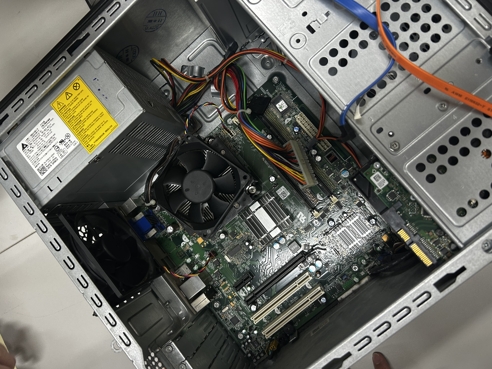
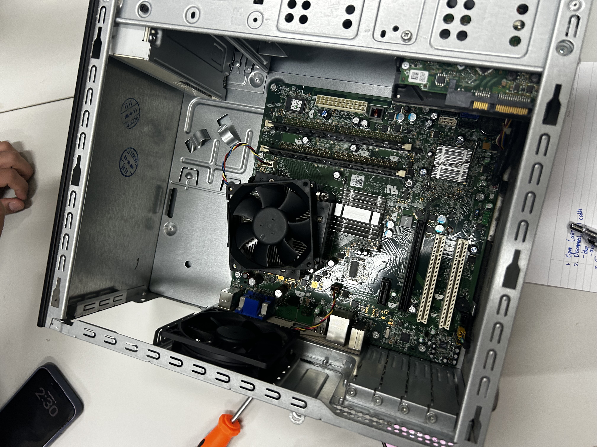
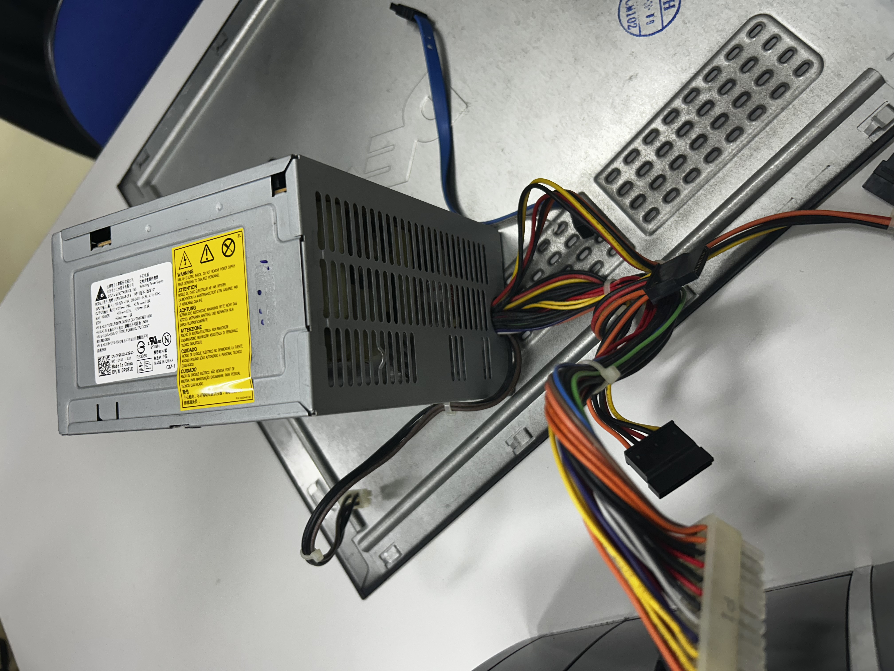
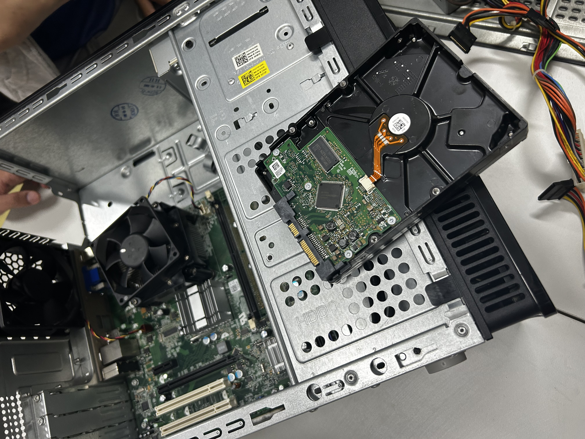
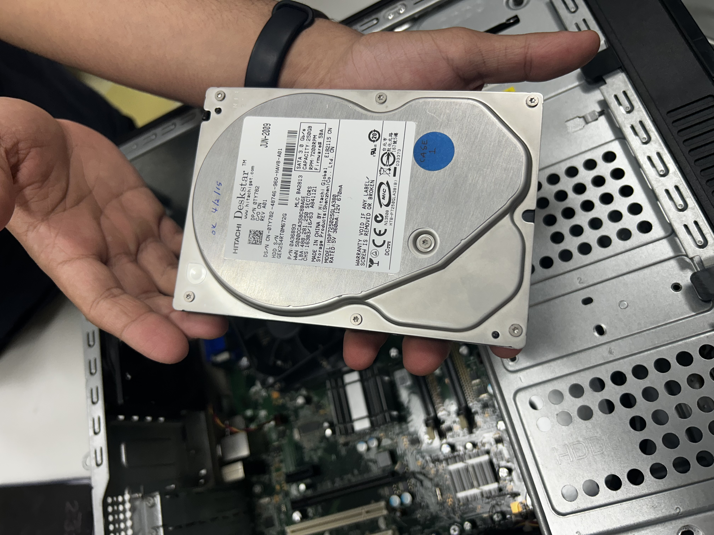
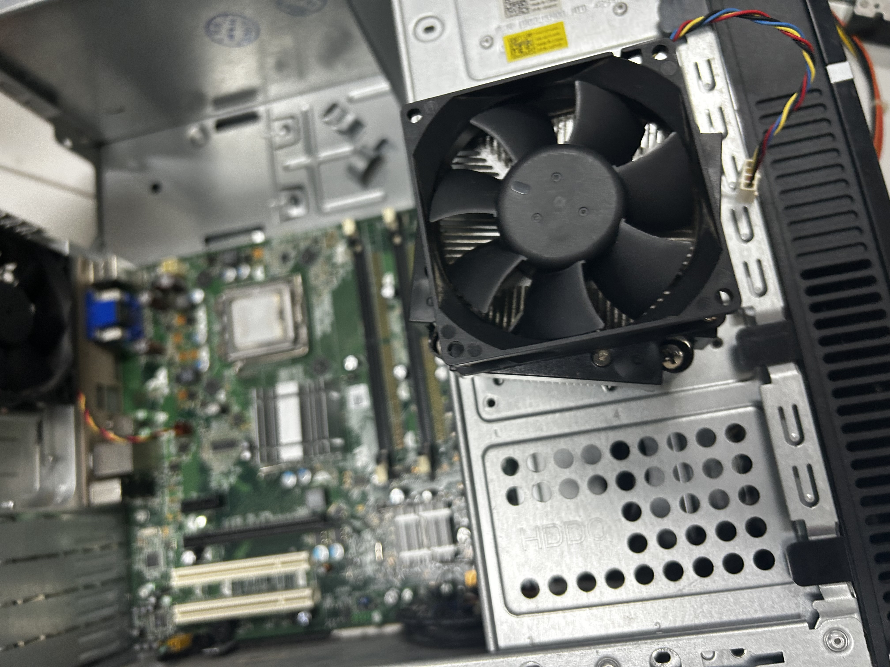
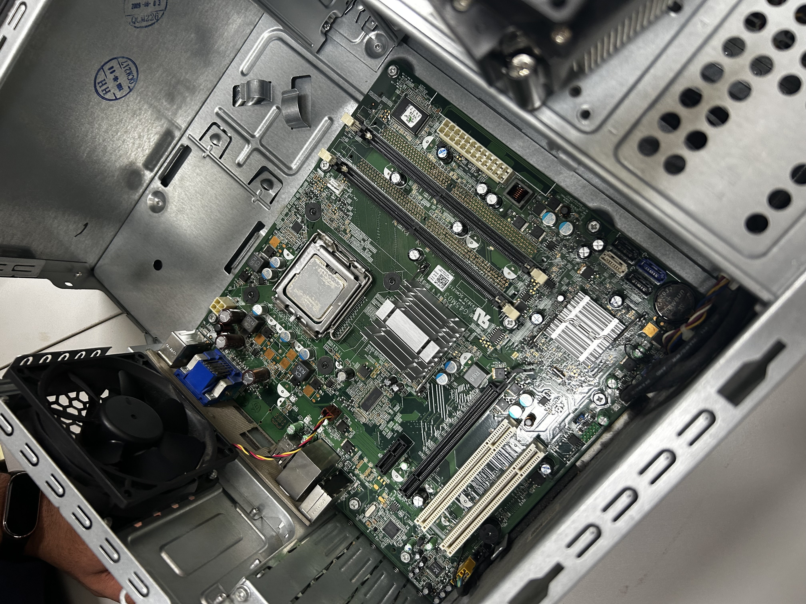
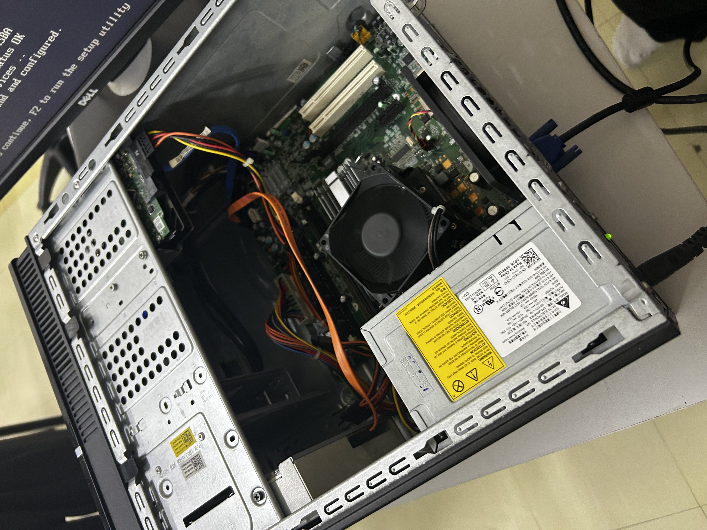

# PC Assembly and Disassembly

Practical lab on opening, disassembling and reassembling a desktop PC.

## Components Identified

- Power supply unit (PSU)
- CPU with heatsink and fan
- Motherboard with RAM slots, PCI and PCIe slots
- Hard disk drive (HDD) with SATA data and power cables

## Photos

