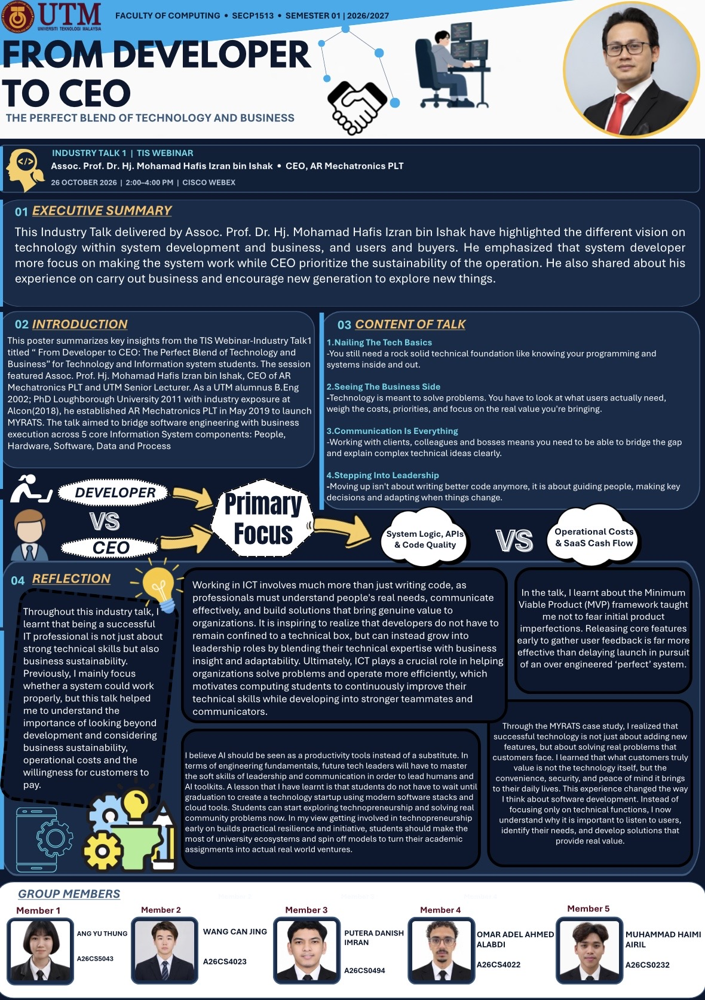

# Industry Talk 1: From Developer to CEO

**The Perfect Blend of Technology and Business**

TIS Webinar | SECP1513 | Faculty of Computing, UTM

## About the Talk

- **Speaker:** Assoc. Prof. Dr. Hj. Mohamad Hafis Izran bin Ishak, CEO of AR Mechatronics PLT
- **Date:** 26 October 2026, 2:00-4:00 PM
- **Platform:** Cisco Webex

## Summary

The talk showed that being an IT professional is not just about coding, but also about understanding users, communicating well, and thinking about business sustainability.

## Group Members

| Name | Matric No. |
|------|-----------|
| Ang Yu Thung | A26CS5043 |
| Wang Can Jing | A26CS4023 |
| Putera Danish Imran | A26CS0494 |
| Omar Adel Ahmed Alabdi | A26CS4022 |
| Muhammad Haimi Airil | A26CS0232 |

